<picture>
  <source media="(prefers-color-scheme: dark)" srcset="./assets/banner-dark.svg">
  <source media="(prefers-color-scheme: light)" srcset="./assets/banner-light.svg">
  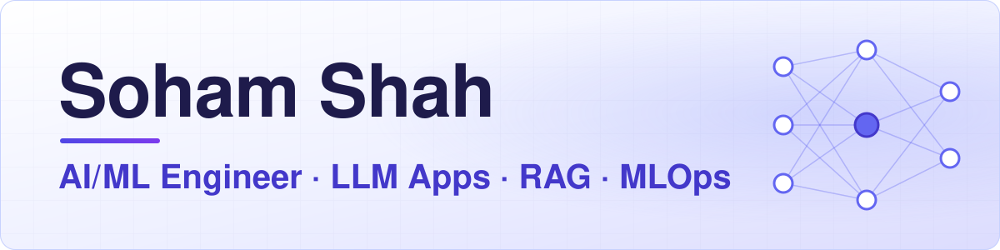
</picture>

  
  
  

<picture>
  <source media="(prefers-color-scheme: dark)" srcset="./assets/sections/about-dark.svg">
  
</picture>

<picture>
  <source media="(prefers-color-scheme: dark)" srcset="./assets/stats-dark.svg">
  
</picture>

- 🎓 **MS in Computer Science**, Arizona State University (May 2026, GPA 3.84)
- 📏 I build LLM apps **and then measure them**: retrieval evals, held-out test sets, ablations and significance tests
- 🚀 Shipped ML to production: FastAPI inference services on **AWS EKS** with Docker and CI/CD
- 📄 Co-author of a **Springer** paper on reinforcement learning for algorithmic trading

<picture>
  <source media="(prefers-color-scheme: dark)" srcset="./assets/sections/work-dark.svg">
  
</picture>

  <a href="https://github.com/soham842op/LiveDocs"><picture><source media="(prefers-color-scheme: dark)" srcset="./assets/cards/livedocs-dark.svg"></picture></a>
  <a href="https://github.com/soham842op/DevLens"><picture><source media="(prefers-color-scheme: dark)" srcset="./assets/cards/devlens-dark.svg"></picture></a>

  <a href="https://github.com/rajmahato111/music_recommendation_system"><picture><source media="(prefers-color-scheme: dark)" srcset="./assets/cards/music-recommender-dark.svg"></picture></a>
  <a href="https://github.com/soham842op/DataWhisperer"><picture><source media="(prefers-color-scheme: dark)" srcset="./assets/cards/datawhisperer-dark.svg"></picture></a>

<picture>
  <source media="(prefers-color-scheme: dark)" srcset="./assets/sections/oss-dark.svg">
  
</picture>

**[Don't Be Michael](https://github.com/agentvivekkumar/dontbemichael)** · a multi-agent desktop app built on Claude Code &nbsp; 

| PR | Status | What I did |
|:--|:--|:--|
| [#601](https://github.com/agentvivekkumar/dontbemichael/pull/601) |  | Fixed the "max turns per run" safety limit for AI agents, which was silently ignored in interactive terminals; added 13 unit tests |
| [#645](https://github.com/agentvivekkumar/dontbemichael/pull/645) |  | Surfaced those stops in the app's safety dashboard |

<picture>
  <source media="(prefers-color-scheme: dark)" srcset="./assets/sections/publication-dark.svg">
  
</picture>

> **Springer chapter · Reinforcement learning for algorithmic trading** &nbsp;
>
> Compared Actor-Critic, Policy Gradient, Q-Learning and Double Dueling Q-Learning on Larsen & Toubro stock data; **Policy Gradient led with a 43.95% ROI**.

<picture>
  <source media="(prefers-color-scheme: dark)" srcset="./assets/sections/toolkit-dark.svg">
  
</picture>

| | |
|:--|:--|
| **ML & data** |  |
| **LLMs & retrieval** | `Gemini API` `Ollama (Llama 3)` `RAG` `pgvector` `FAISS` `MCP` |
| **Backend & MLOps** |  |
| **Frontend** |  |

<picture>
  <source media="(prefers-color-scheme: dark)" srcset="./assets/footer-dark.svg">
  <source media="(prefers-color-scheme: light)" srcset="./assets/footer-light.svg">
  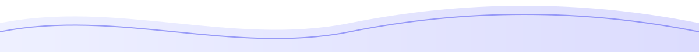
</picture>
