<picture>
  <source media="(prefers-color-scheme: dark)" srcset="./assets/hero-dark.svg">
  <source media="(prefers-color-scheme: light)" srcset="./assets/hero-light.svg">
  
</picture>

[LinkedIn](https://www.linkedin.com/in/soham-shah842/) &nbsp;·&nbsp; [sshah270@asu.edu](mailto:sshah270@asu.edu) &nbsp;·&nbsp; [Try LiveDocs](https://live-docs-ten-neon.vercel.app)

### About

Most of what I build is LLM software, and I care a lot about proving it works: retrieval evals, held-out test sets, ablations and significance tests.

<picture>
  <source media="(prefers-color-scheme: dark)" srcset="./assets/about-dark.svg">
  
</picture>

### Projects

  <a href="https://github.com/soham842op/LiveDocs"><picture><source media="(prefers-color-scheme: dark)" srcset="./assets/work/livedocs-dark.svg"></picture></a>
  <a href="https://github.com/soham842op/DevLens"><picture><source media="(prefers-color-scheme: dark)" srcset="./assets/work/devlens-dark.svg"></picture></a>

  <a href="https://github.com/rajmahato111/music_recommendation_system"><picture><source media="(prefers-color-scheme: dark)" srcset="./assets/work/music-recommender-dark.svg"></picture></a>
  <a href="https://github.com/soham842op/DataWhisperer"><picture><source media="(prefers-color-scheme: dark)" srcset="./assets/work/datawhisperer-dark.svg"></picture></a>

### Open source

I contribute to [Don't Be Michael](https://github.com/agentvivekkumar/dontbemichael), a multi-agent desktop app built on Claude Code (590+ stars, MIT).

- [#601](https://github.com/agentvivekkumar/dontbemichael/pull/601) (merged): the "max turns per run" safety limit for agents was silently ignored in interactive terminals. I fixed it and added 13 unit tests.
- [#645](https://github.com/agentvivekkumar/dontbemichael/pull/645) (in review): shows those stops in the app's safety dashboard.

### Publication

[Reinforcement learning for algorithmic trading](https://link.springer.com/chapter/10.1007/978-981-96-2179-8_31), Springer. We compared Actor-Critic, Policy Gradient, Q-Learning and Double Dueling Q-Learning on Larsen & Toubro stock data. Policy Gradient came out ahead with a 43.95% ROI.

### Toolkit

| | |
|:--|:--|
| ML and data |  |
| LLMs and retrieval | Gemini API, Ollama (Llama 3), RAG, pgvector, FAISS, MCP |
| Backend and MLOps |  |
| Frontend |  |

### Lately on GitHub

<picture>
  <source media="(prefers-color-scheme: dark)" srcset="https://raw.githubusercontent.com/soham842op/soham842op/output/snake-cobalt-dark.svg">
  
</picture>

Thanks for reading. If something here overlaps with what you're working on, I'd like to hear about it.
